# aws-iam-cloud-security-project
Secure AWS environment for Elixtech: IAM least privilege, CloudTrail and EventBridge alerts, KMS-encrypted DynamoDB, and a governed Amazon Bedrock RAG chatbot.


# AWS IAM Cloud Security Project
 
A hands-on cloud security project built for a fictional organisation, **Elixtech**, on AWS. It covers identity and access management, audit logging and real-time alerting, data encryption with customer managed keys, least-privilege access to storage, compute and a database, and a governed AI chatbot that follows the organisation's AI Use Policy.
 
Every control in this repository is backed by a screenshot from the working environment. Account IDs, ARNs, key IDs, instance IDs, IP addresses and email addresses have been blurred.
 

The goal was to design and implement a secure AWS environment for Elixtech using the principle of **least privilege**. Users are organised into IAM groups by job function, each group can reach only the resources its role needs, activity is recorded and alerts are sent in real time, sensitive data is encrypted with a key the organisation controls, and AI tooling is kept inside a governed environment instead of public AI services.
 
**Region:** US East (N. Virginia), `us-east-1`
**Timeline:** October 2026
 
## Services used
 
| Service | Purpose |
|---|---|
| AWS IAM | Users, groups, MFA, inline and managed policies |
| Amazon S3 | Team buckets for access tests, and the knowledge base documents |
| Amazon EC2 | Servers used to test permission boundaries |
| AWS CloudTrail | Multi-region audit trail of API activity |
| Amazon CloudWatch Logs | Log delivery from CloudTrail |
| Amazon EventBridge | Rule that detects S3 bucket creation and deletion |
| Amazon SNS | Email alerts for monitored events |
| AWS KMS | Customer managed encryption keys |
| Amazon DynamoDB | Encrypted table with group-based access |
| Amazon Bedrock | Knowledge Base chatbot using Retrieval Augmented Generation (RAG) |
| Amazon OpenSearch Serverless | Vector store for the knowledge base |
 
## Project summary
 
| Part | Focus | Main control | Primary CIA focus |
|---|---|---|---|
| 1 | IAM users, groups, MFA, team permissions | Role-based access and least privilege | Confidentiality, Integrity |
| 2 | CloudTrail, EventBridge and SNS | Audit logging with real-time alerts | Integrity, Availability |
| 3 | KMS and DynamoDB | Encryption at rest and scoped access | Confidentiality, Integrity |
| 4 | Bedrock Knowledge Base | Governed AI aligned to the AI Use Policy | Confidentiality, Integrity |
 
---
 
## Part 1: Identity and access management
 
### 1.1 Starting point: IAM dashboard
 
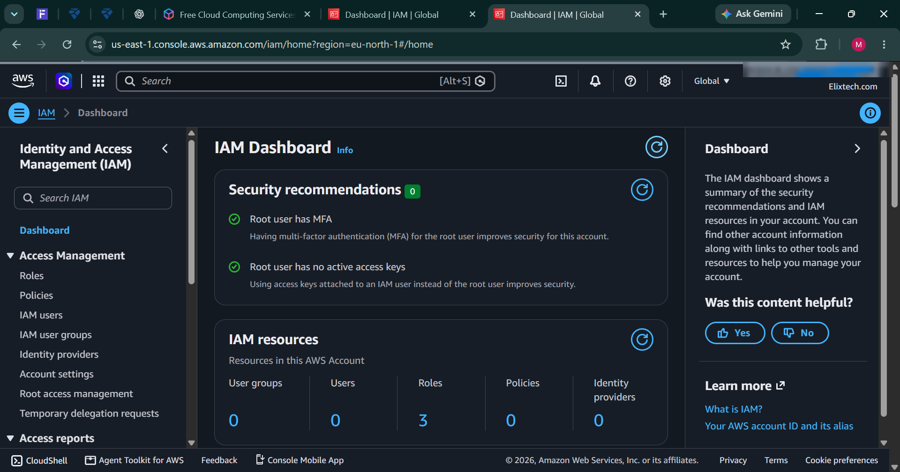
 
The IAM dashboard before any users or groups were created. The root user has MFA enabled and no active access keys, which gives a secure baseline to build from. The account had no users or groups yet, and only the default roles.
 
### 1.2 Creating the administrator user
 
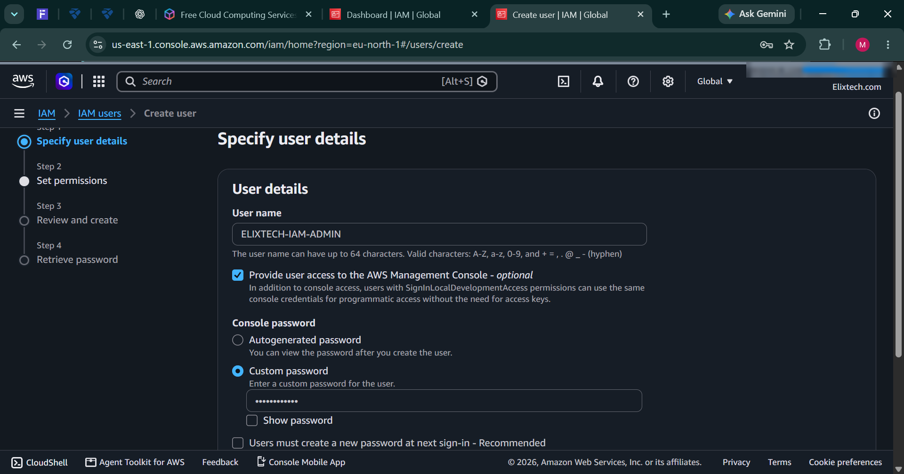
 
A dedicated administrator, `ELIXTECH-IAM-ADMIN`, was created with console access so that day-to-day work is not done as the root user.
 
### 1.3 Enforcing MFA
 
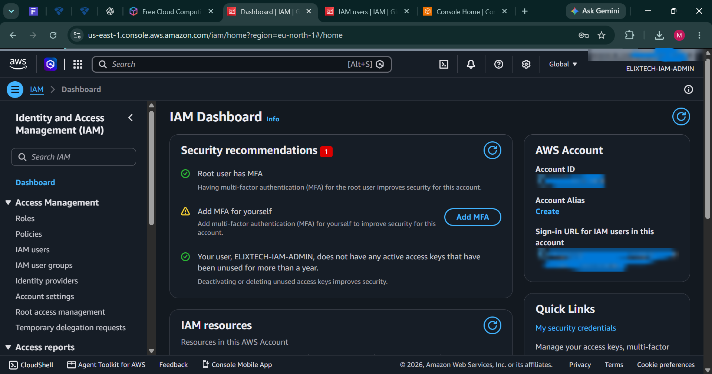
 
After signing in as the new admin, the dashboard raised a security recommendation to add MFA for the user.
 
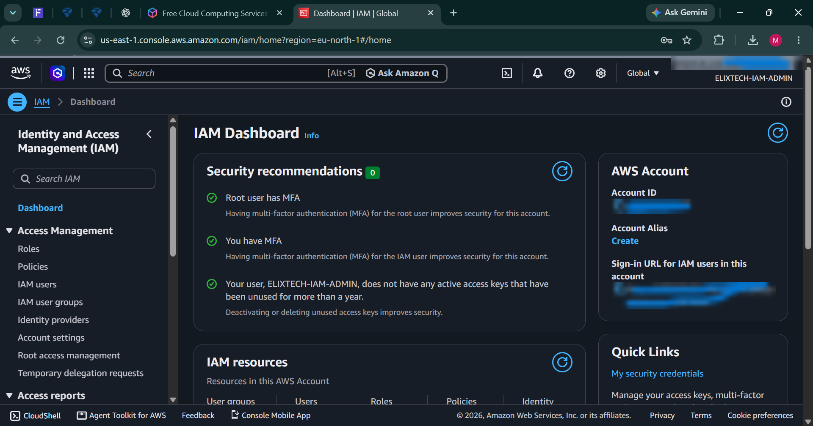
 
After registering a virtual MFA device, the recommendation cleared and the dashboard shows that MFA is in place for both the root user and the admin user.
 
### 1.4 User groups and users
 
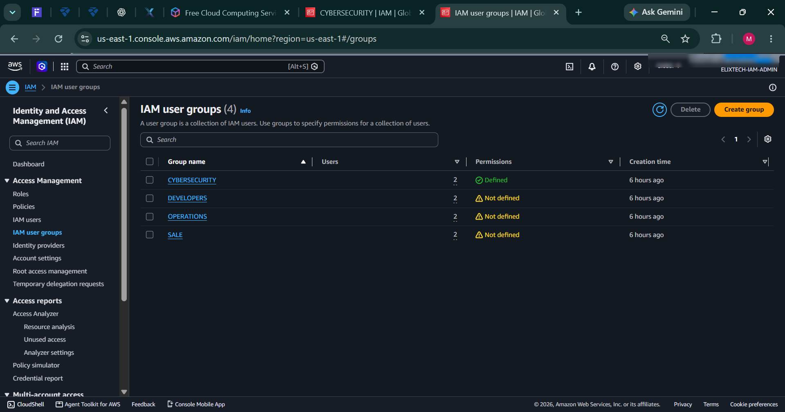
 
Four user groups were created, one per job function: **CYBERSECURITY**, **DEVELOPERS**, **OPERATIONS** and **SALE**, with two users in each. At this point only CYBERSECURITY has permissions defined. The other three show as "Not defined", which the next steps fix.
 
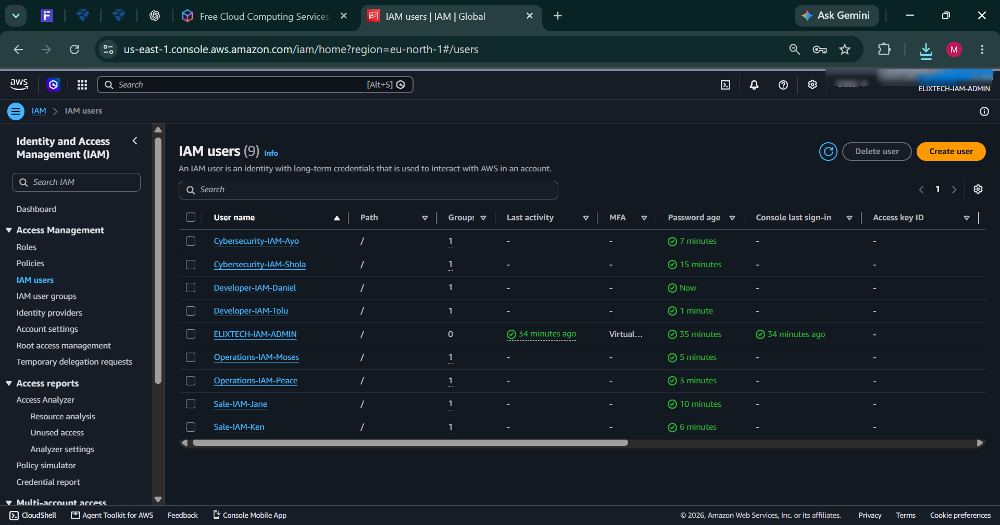
 
Nine IAM users exist. Eight belong to one of the four groups, and the administrator account sits outside the groups with a virtual MFA device.
 
| Group | Users |
|---|---|
| CYBERSECURITY | Cybersecurity-IAM-Ayo, Cybersecurity-IAM-Shola |
| DEVELOPERS | Developer-IAM-Daniel, Developer-IAM-Tolu |
| OPERATIONS | Operations-IAM-Moses, Operations-IAM-Peace |
| SALE | Sale-IAM-Jane, Sale-IAM-Ken |
 
Assigning permissions to groups instead of individuals keeps access consistent and easy to audit.
 
### 1.5 Group permissions
 
Each group received only the access its role needs.
 
| Group | Access granted |
|---|---|
| CYBERSECURITY | AWS managed policies `AmazonEC2FullAccess` and `AmazonS3FullAccess`, plus the DynamoDB inline policy in [Part 3](#35-granting-access-through-an-inline-group-policy) |
| DEVELOPERS | View EC2 instances, start/stop/reboot only the developer server, and full S3 access to the developer bucket |
| OPERATIONS | List buckets and read, write and delete objects in the operations bucket only |
 
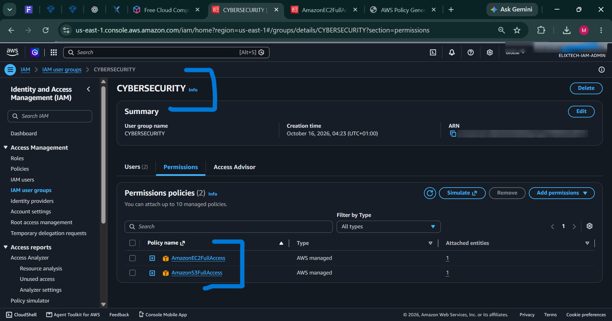
 
The CYBERSECURITY group has the AWS managed policies for EC2 and S3 attached.
 
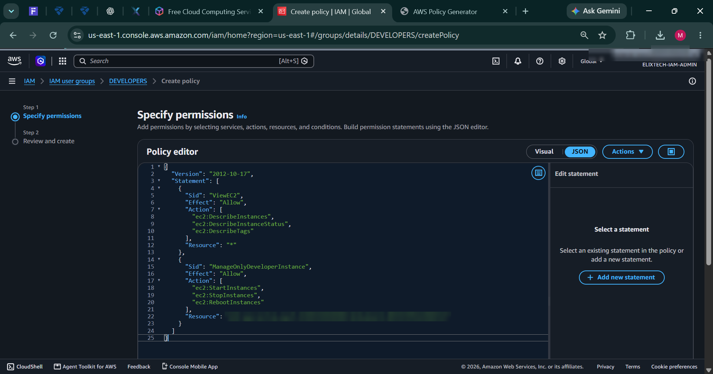
 
The DEVELOPERS group's EC2 policy has two statements. `ViewEC2` allows read-only describe actions on all instances. `ManageOnlyDeveloperInstance` allows only start, stop and reboot, and only on the single developer instance, so developers cannot touch other servers.
 
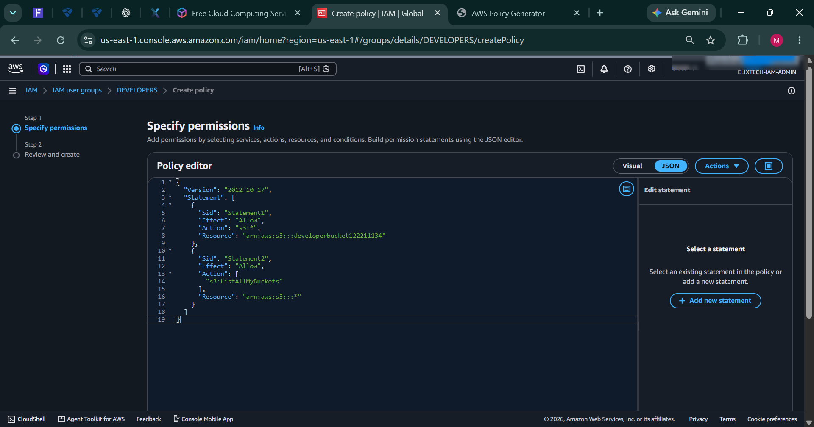
 
The DEVELOPERS S3 policy gives full S3 actions on the developer bucket and the ability to list buckets, but nothing on other buckets.
 
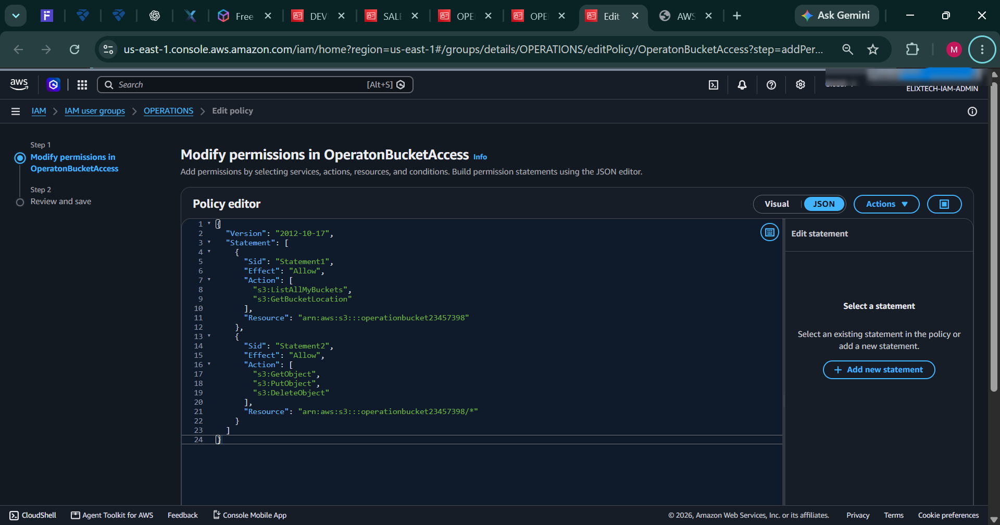
 
The OPERATIONS policy allows listing buckets and getting the bucket location, plus `GetObject`, `PutObject` and `DeleteObject` on the operations bucket only.
 
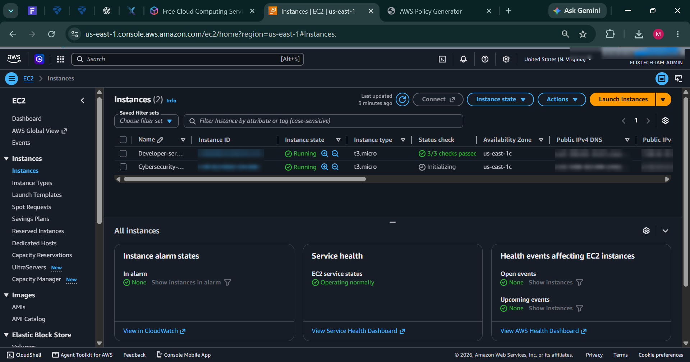
 
Two `t3.micro` EC2 instances run in `us-east-1c`: one for developers and one for the cybersecurity team. They provide a target for testing the EC2 permissions above.
 
### 1.6 Testing the permission boundaries
 
Each policy was tested by signing in as a user from the group.
 
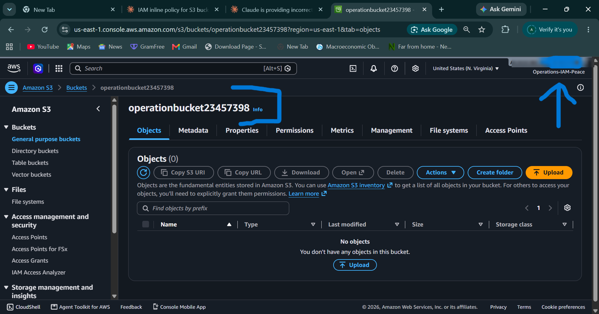
 
**Allowed:** signed in as an Operations user, the operations bucket opens successfully.
 
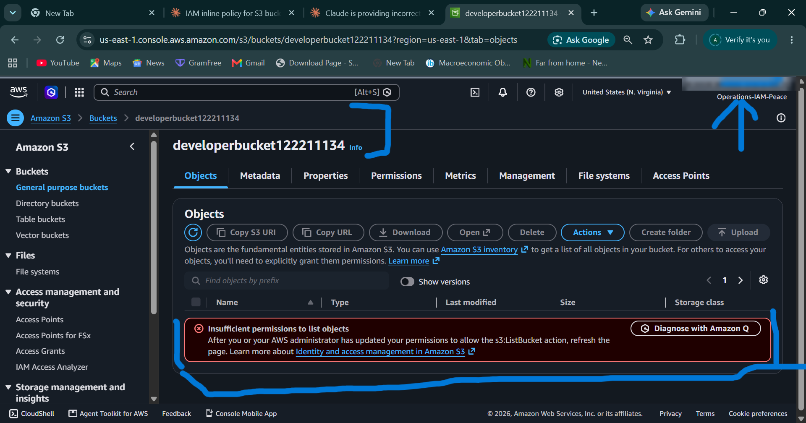
 
**Denied:** the same Operations user opens the developer bucket and gets "Insufficient permissions to list objects". Operations users cannot reach another team's data.
 
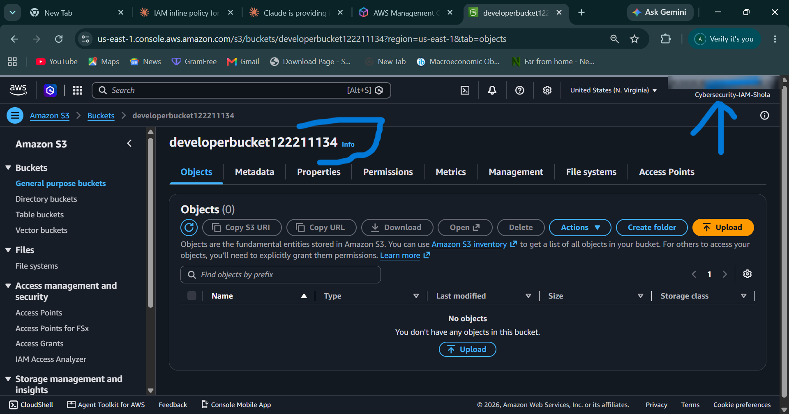
 
**Allowed by broader role:** a Cybersecurity user opens the same developer bucket without error, because the CYBERSECURITY group holds `AmazonS3FullAccess`. The two screenshots side by side show the same resource behaving differently for different roles.
 
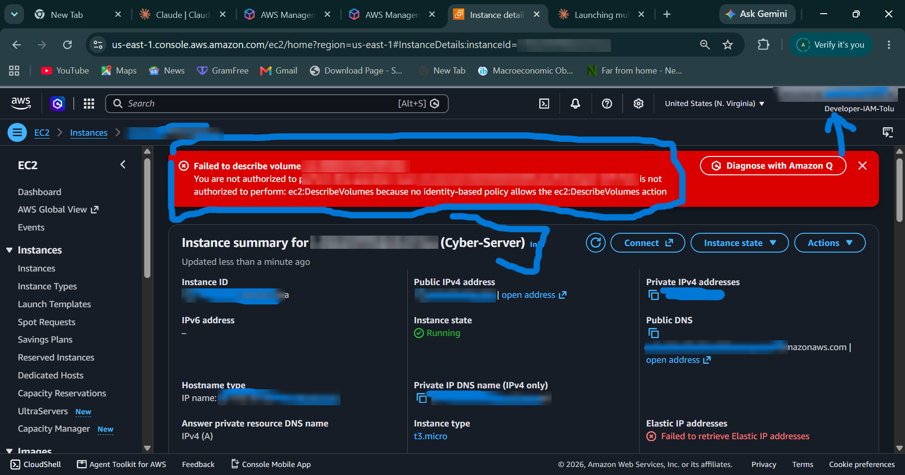
 
**Denied:** a Developer user viewing the `Cyber-Server` instance receives an authorisation error, because no identity-based policy allows `ec2:DescribeVolumes`. Permissions are limited to what each group was granted.
 
---
 
## Part 2: Logging, monitoring and alerting
 
The alerting pipeline works like this:
 
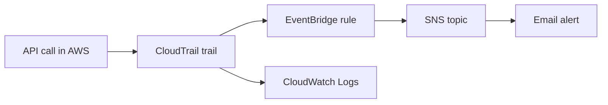
 
### 2.1 CloudTrail trail
 
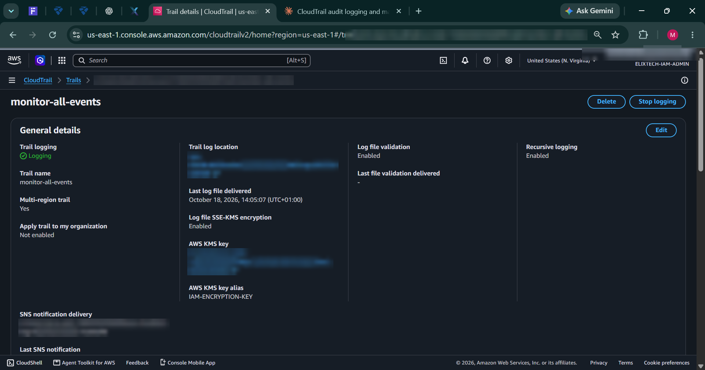
 
The trail `monitor-all-events` records management events across all regions. Key settings visible in the screenshot:
 
- Logging is active and the trail is multi-region
- Log file validation is enabled, so tampering with delivered logs can be detected
- Log files are encrypted with SSE-KMS using a customer managed key
- An SNS topic is attached for notification delivery
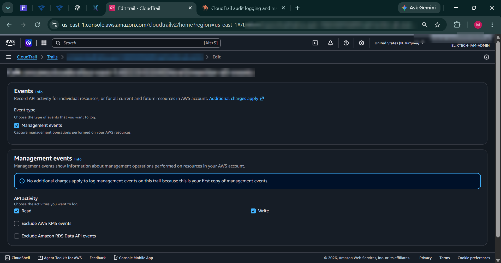
 
Management events are captured for both **read** and **write** API activity, so the trail shows who viewed resources as well as who changed them. No additional charges apply because this is the first copy of management events.
 
### 2.2 CloudWatch Logs integration
 
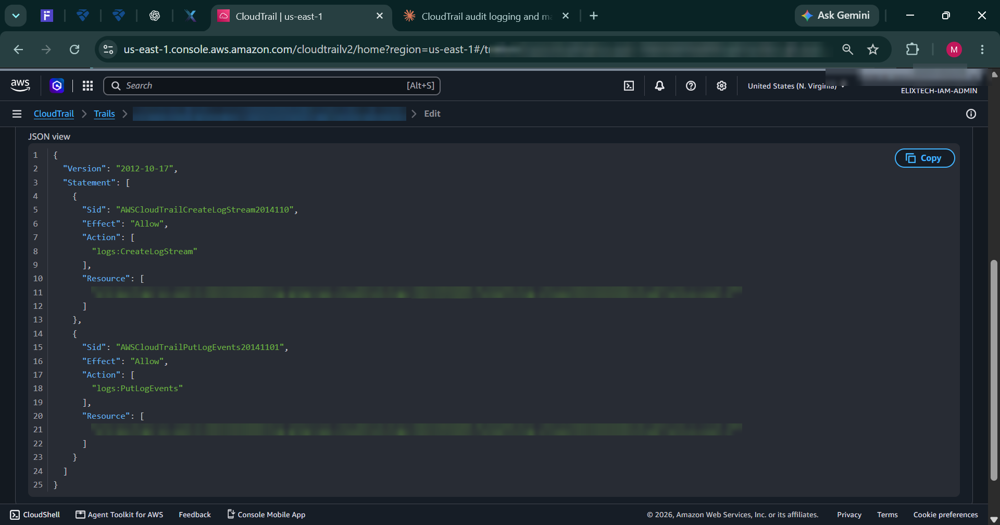
 
The policy that lets CloudTrail write to CloudWatch Logs. It allows only `logs:CreateLogStream` and `logs:PutLogEvents`, scoped to the trail's own log group and stream.
 
### 2.3 SNS topic and EventBridge rule
 
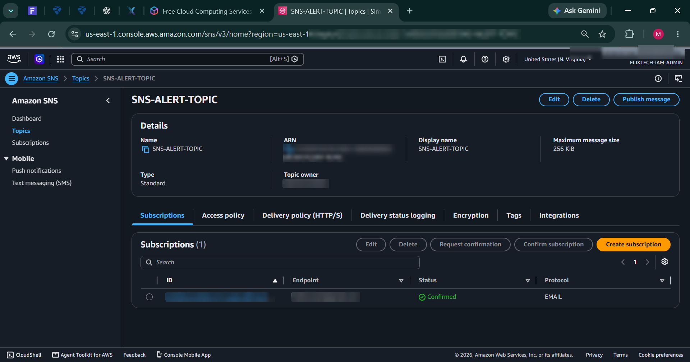
 
The SNS topic `SNS-ALERT-TOPIC` has one email subscription, and its status is **Confirmed**, so alerts are delivered to the security contact.
 
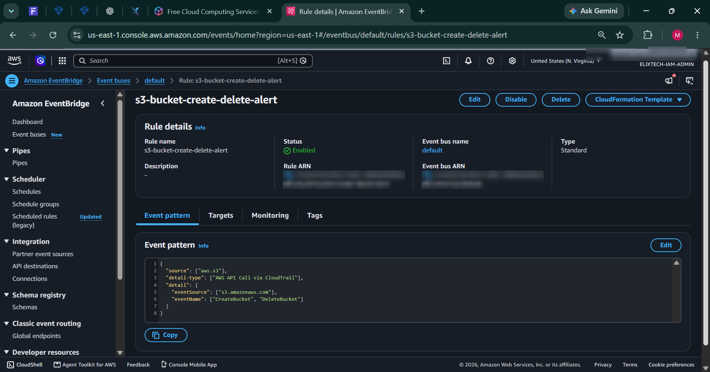
 
The EventBridge rule `s3-bucket-create-delete-alert` is enabled on the default event bus. Its event pattern matches CloudTrail API calls from `s3.amazonaws.com` where the event name is `CreateBucket` or `DeleteBucket`, so any time a bucket is created or removed an alert is triggered.
 
### 2.4 Real-time email alert
 
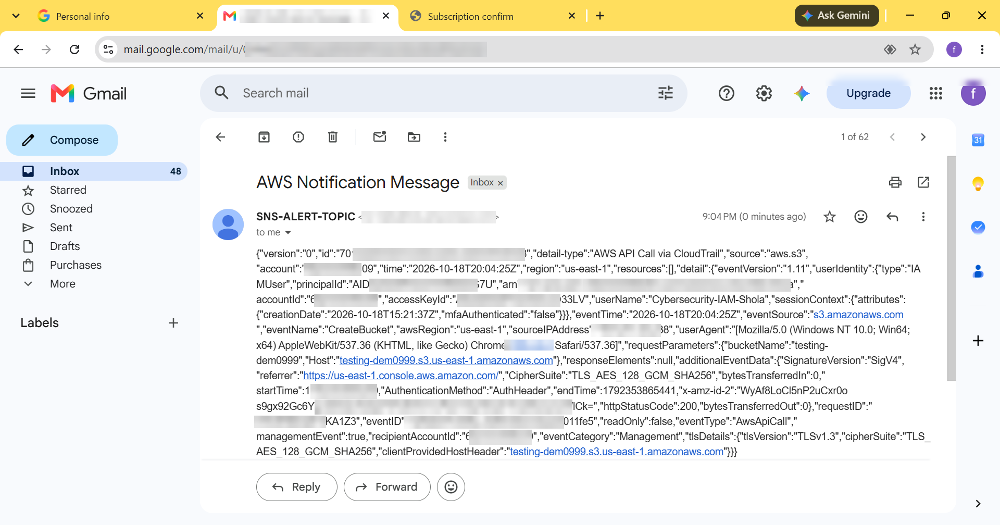
 
To test the pipeline, a test S3 bucket was created. Within moments, an email arrived from the SNS alert topic containing the CloudTrail event: an `AWS API Call via CloudTrail` with event name `CreateBucket`, source `s3.amazonaws.com`, region `us-east-1`, made by IAM user `Cybersecurity-IAM-Shola`. The alert records who did what, when, and from where.
 
### 2.5 Cleaning up the test resource
 
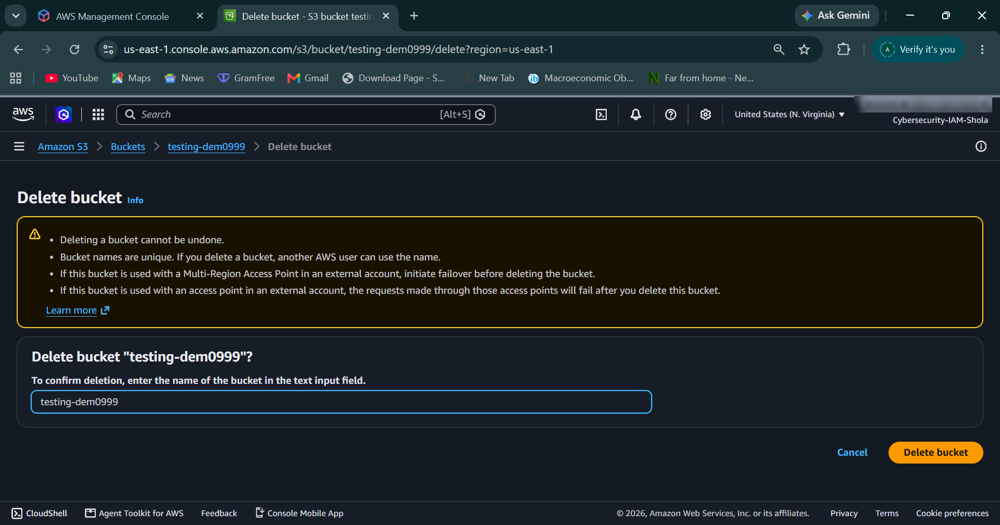
 
The test bucket `testing-dem0999` was then deleted, which follows good housekeeping and avoids leaving unused resources behind. Deletion is also covered by the same EventBridge rule.
 
---
 
## Part 3: Encryption and database access control
 
### 3.1 Customer managed keys in KMS
 
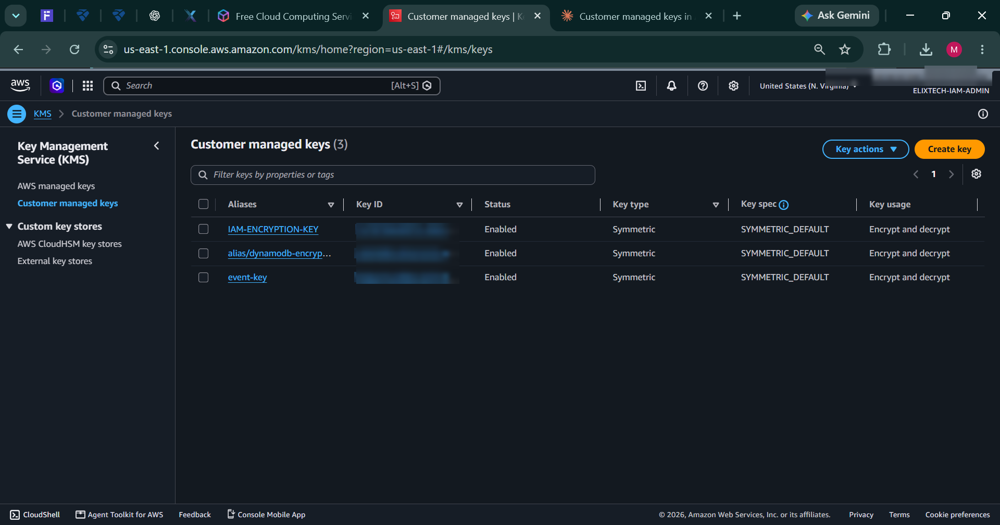
 
Three symmetric customer managed keys (encrypt and decrypt) exist in the account, all enabled. One of them, with an alias beginning `alias/dynamodb-encryp...`, was created specifically to encrypt the DynamoDB table. A customer managed key gives full control over the key policy, rotation and deletion, unlike AWS managed keys.
 
### 3.2 Key administrators and key deletion
 
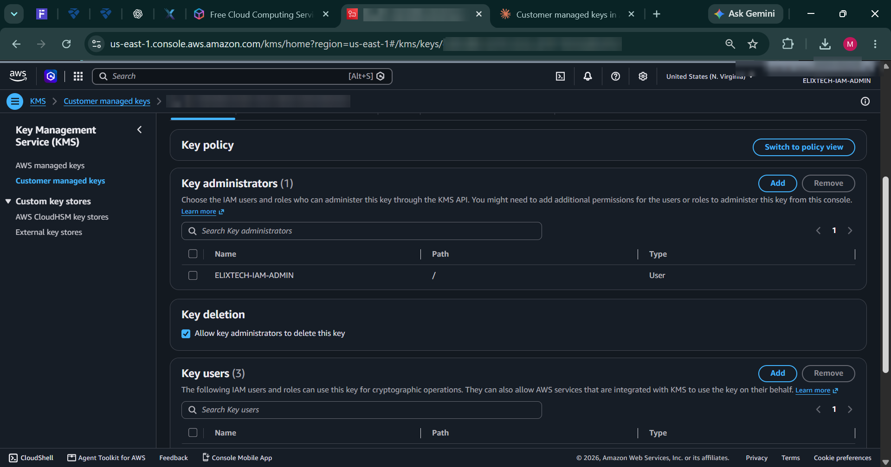
 
The key policy separates duties. `ELIXTECH-IAM-ADMIN` is the key administrator, which means it can manage the key but is not automatically a key user.
 
### 3.3 Key users
 
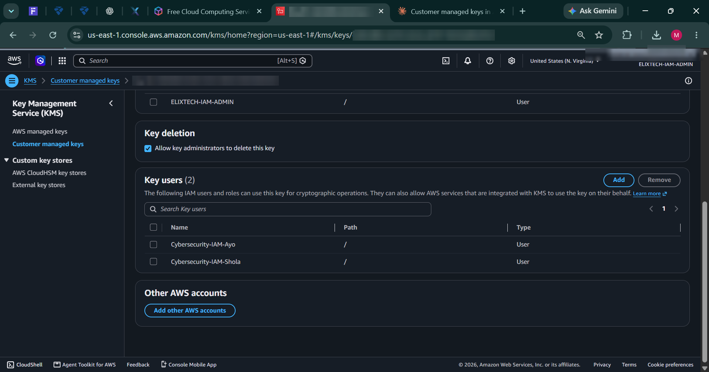
 
Only specific IAM users are listed as key users, meaning only they can use the key for cryptographic operations. No other AWS accounts have been granted access to the key.
 
### 3.4 Encrypted DynamoDB table
 
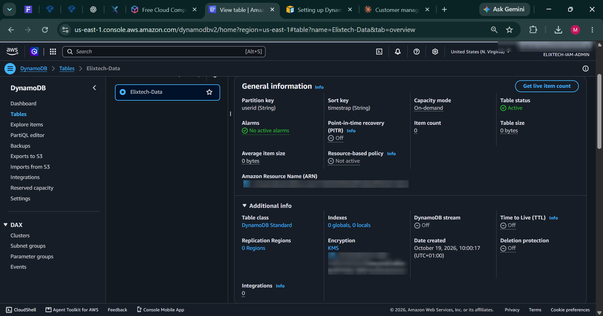
 
The table `Elixtech-Data` is active, uses on-demand capacity, and has `userid` as its partition key. Under **Encryption**, the table is protected with the customer managed KMS key, so all data written to it is encrypted at rest and the key policy controls who can read it. Without access to the key, the stored data cannot be read, even by AWS support.
 
### 3.5 Granting access through an inline group policy
 
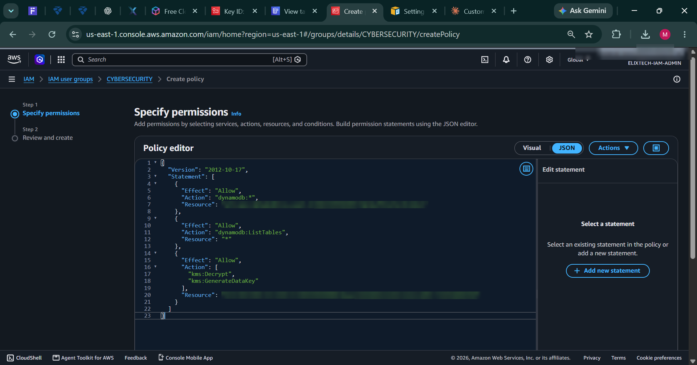
 
An inline policy was added to the CYBERSECURITY group with three statements: full DynamoDB access scoped to the single table, `ListTables` so users can see tables in the console, and the KMS permissions needed to read and write encrypted data (`kms:Decrypt` and `kms:GenerateDataKey`) scoped to the one key.
 
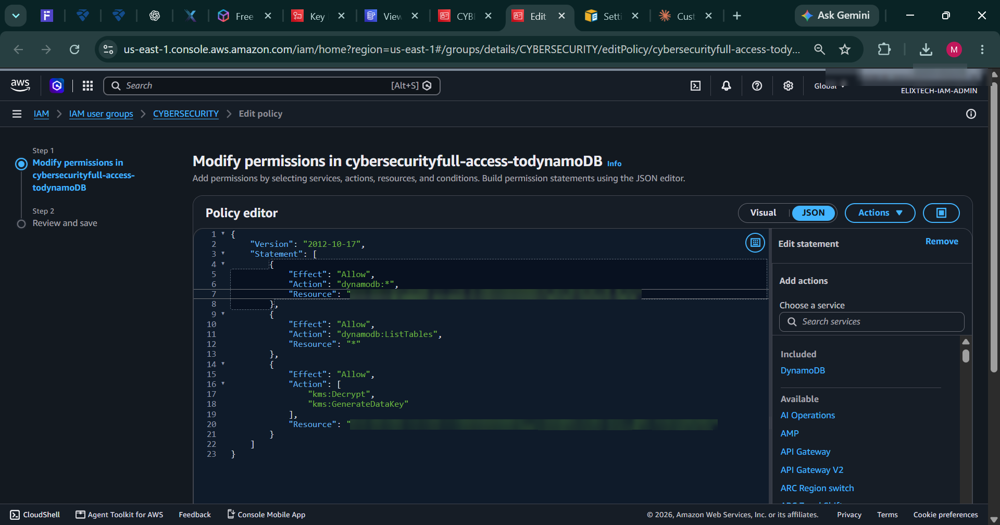
 
The policy was reviewed and adjusted in the policy editor before saving.
 
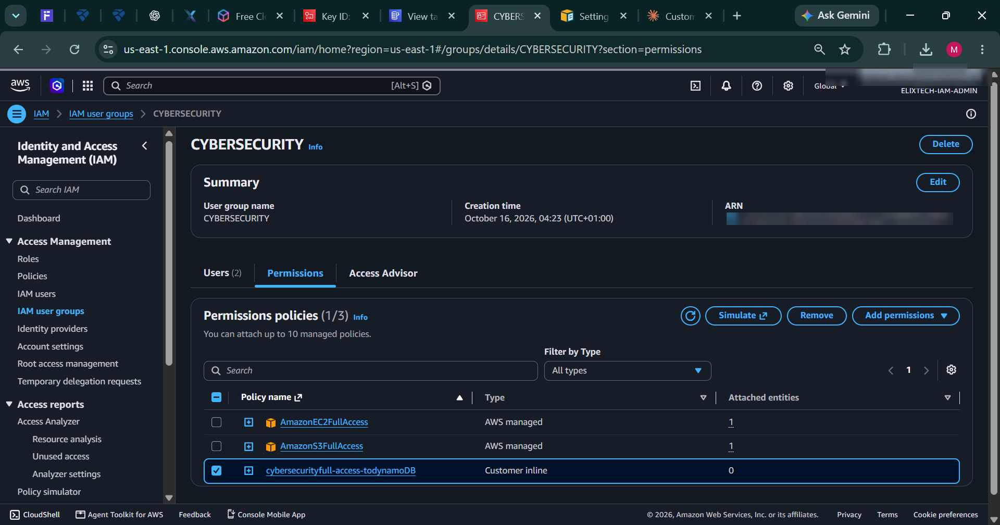
 
The group now shows three permissions policies: the two AWS managed policies and the customer inline policy `cybersecurityfull-access-todynamoDB`.
 
**Access model:** IT users receive full DynamoDB access, while content group users receive read-only access appropriate to their role. Users need permission on **both** the table and the encryption key, which creates two layers of control. Policy examples are in [IAM policies used](#iam-policies-used).
 
---
 
## Part 4: Governed AI chatbot (Amazon Bedrock)
 
The final phase was an AI chatbot built with the **Amazon Bedrock Knowledge Base** feature. It supports the organisation's AI Use Policy, which requires that any AI tooling used to query internal documentation runs inside a governed, organisation-controlled environment rather than through public AI services.
 
The chatbot uses a **Retrieval Augmented Generation (RAG)** architecture:
 
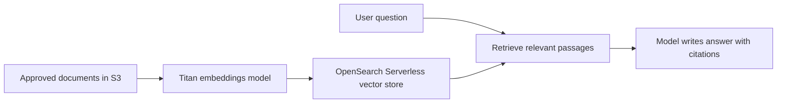
 
When a question is asked, the system retrieves relevant passages from approved documents and gives them to the model, so answers are grounded in those documents. This significantly reduces hallucination on sensitive topics, and keeps AI interactions within the organisational boundary.
 
### 4.1 Approved source documents
 
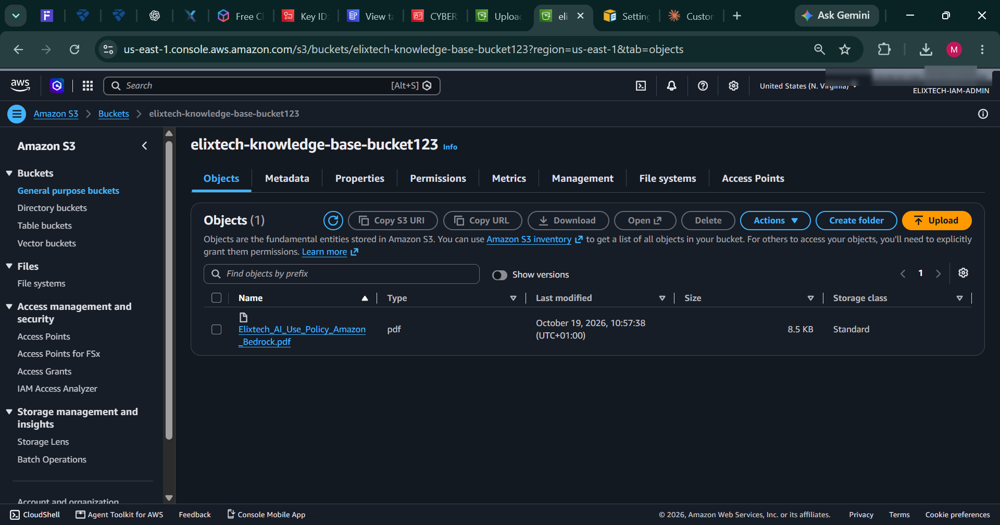
 
The AI Use Policy PDF is stored in the S3 bucket that serves as the knowledge base source, so the chatbot answers from approved material only.
 
### 4.2 Embedding model and vector store
 
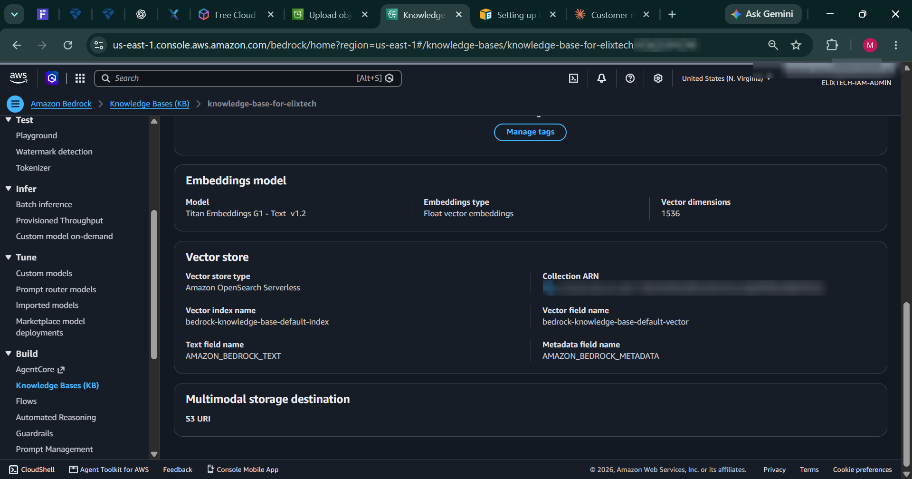
 
The knowledge base `knowledge-base-for-elixtech` is configured with:
 
- **Embeddings model:** Titan Embeddings G1 - Text v1.2, which converts document text into 1536-dimension float vectors for semantic search
- **Vector store:** Amazon OpenSearch Serverless, with Bedrock creating the vector index automatically
### 4.3 Testing the knowledge base
 
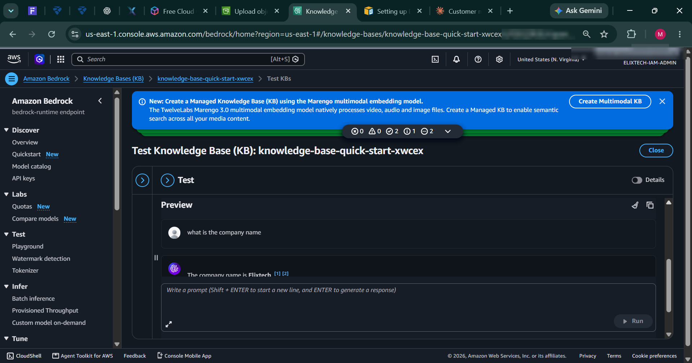
 
In the Bedrock test panel, the question "what is the company name" returns "The company name is Elixtech" with citation markers pointing back to the source documents. The citations show that the answer comes from the approved knowledge base and not from the model's general knowledge.
 
The policy that governs the chatbot is included in this repository: [`docs/Elixtech_AI_Use_Policy_Amazon_Bedrock.pdf`](docs/Elixtech_AI_Use_Policy_Amazon_Bedrock.pdf).
 
---
 
## IAM policies used
 
Values in angle brackets are placeholders. Replace them with your own region, account ID, instance ID and key ID.
 
**CYBERSECURITY group (IT): full access to the DynamoDB table**
 
```json
{
  "Version": "2012-10-17",
  "Statement": [
    {
      "Effect": "Allow",
      "Action": "dynamodb:*",
      "Resource": "arn:aws:dynamodb:<REGION>:<ACCOUNT_ID>:table/Elixtech-Data"
    },
    {
      "Effect": "Allow",
      "Action": "dynamodb:ListTables",
      "Resource": "*"
    },
    {
      "Effect": "Allow",
      "Action": ["kms:Decrypt", "kms:GenerateDataKey"],
      "Resource": "arn:aws:kms:<REGION>:<ACCOUNT_ID>:key/<KEY_ID>"
    }
  ]
}
```
 
**Content group: read-only access to the DynamoDB table**
 
```json
{
  "Version": "2012-10-17",
  "Statement": [
    {
      "Effect": "Allow",
      "Action": [
        "dynamodb:GetItem",
        "dynamodb:Query",
        "dynamodb:Scan",
        "dynamodb:DescribeTable"
      ],
      "Resource": "arn:aws:dynamodb:<REGION>:<ACCOUNT_ID>:table/Elixtech-Data"
    },
    {
      "Effect": "Allow",
      "Action": "dynamodb:ListTables",
      "Resource": "*"
    },
    {
      "Effect": "Allow",
      "Action": "kms:Decrypt",
      "Resource": "arn:aws:kms:<REGION>:<ACCOUNT_ID>:key/<KEY_ID>"
    }
  ]
}
```
 
The read-only policy omits `kms:GenerateDataKey`. Reading needs decryption, while only writing needs new data keys, so least privilege is applied at the key level as well as the table level.
 
**DEVELOPERS group: EC2 access limited to the developer server**
 
```json
{
  "Version": "2012-10-17",
  "Statement": [
    {
      "Sid": "ViewEC2",
      "Effect": "Allow",
      "Action": [
        "ec2:DescribeInstances",
        "ec2:DescribeInstanceStatus",
        "ec2:DescribeTags"
      ],
      "Resource": "*"
    },
    {
      "Sid": "ManageOnlyDeveloperInstance",
      "Effect": "Allow",
      "Action": [
        "ec2:StartInstances",
        "ec2:StopInstances",
        "ec2:RebootInstances"
      ],
      "Resource": "arn:aws:ec2:<REGION>:<ACCOUNT_ID>:instance/<INSTANCE_ID>"
    }
  ]
}
```
 
**DEVELOPERS group: S3 access to the developer bucket**
 
```json
{
  "Version": "2012-10-17",
  "Statement": [
    {
      "Sid": "Statement1",
      "Effect": "Allow",
      "Action": "s3:*",
      "Resource": "arn:aws:s3:::developerbucket122211134"
    },
    {
      "Sid": "Statement2",
      "Effect": "Allow",
      "Action": ["s3:ListAllMyBuckets"],
      "Resource": "arn:aws:s3:::*"
    }
  ]
}
```
 
**OPERATIONS group: S3 access to the operations bucket**
 
```json
{
  "Version": "2012-10-17",
  "Statement": [
    {
      "Sid": "Statement1",
      "Effect": "Allow",
      "Action": ["s3:ListAllMyBuckets", "s3:GetBucketLocation"],
      "Resource": "arn:aws:s3:::operationbucket23457398"
    },
    {
      "Sid": "Statement2",
      "Effect": "Allow",
      "Action": ["s3:GetObject", "s3:PutObject", "s3:DeleteObject"],
      "Resource": "arn:aws:s3:::operationbucket23457398/*"
    }
  ]
}
```
 
## CIA triad alignment
 
| Principle | How the project supports it |
|---|---|
| **Confidentiality** | KMS customer managed keys encrypt data at rest; each team can reach only its own bucket and server; MFA protects privileged accounts; AI queries stay inside the governed AWS environment |

| **Integrity** | Read-only access prevents content users from changing data; CloudTrail log file validation detects tampering; EventBridge alerts on bucket creation and deletion; the chatbot answers only from approved documents |

| **Availability** | Multi-region logging and real-time alerts support fast response; developers can restart only their own server; managed AWS services keep documentation accessible; key lifecycle controls guard against accidental lockout |
 
## Skills demonstrated
 
- Designing role-based access with IAM users, groups and inline policies
- Applying the principle of least privilege and testing both allowed and denied actions
- Scoping EC2 and S3 permissions to individual resources
- Enabling MFA and following account security recommendations
- Configuring CloudTrail, CloudWatch Logs, EventBridge and SNS for audit logging and alerting
- Managing KMS customer managed keys, key administrators and key users
- Encrypting DynamoDB data at rest and securing access to it
- Writing and reviewing IAM JSON policies
- Building a RAG chatbot with Amazon Bedrock, Titan embeddings and OpenSearch Serverless
- Aligning technical controls to the CIA triad and an organisational AI Use Policy

 
## Note on redaction
 
Account IDs, ARNs, key IDs, resource IDs, IP addresses and email addresses were blurred before publishing. If you reproduce this project, never commit real access keys, passwords or account identifiers to a public repository.
 
